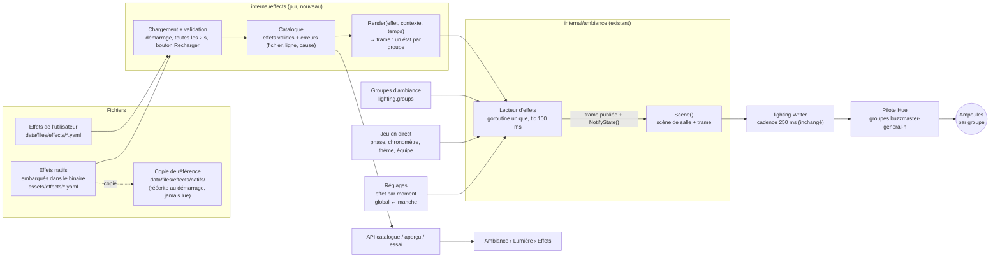
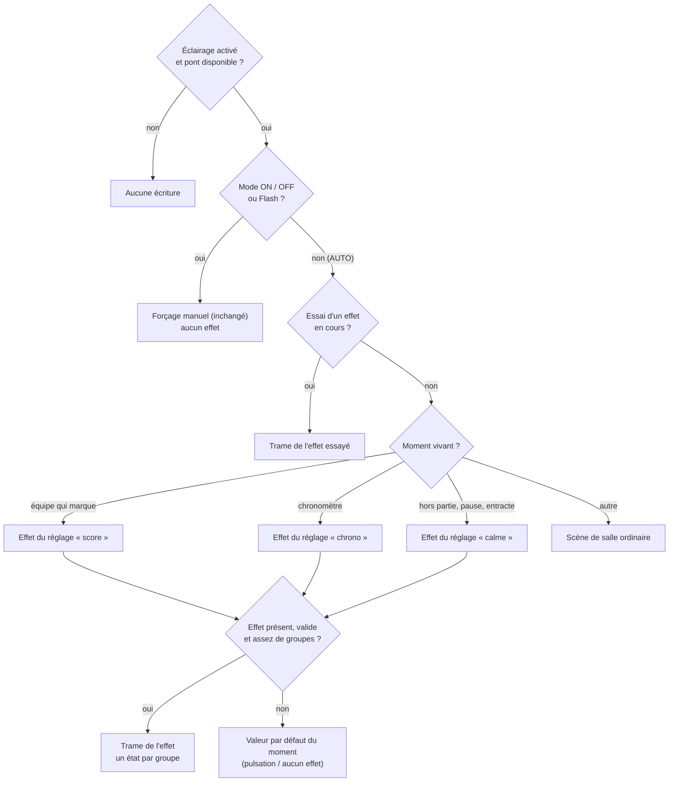
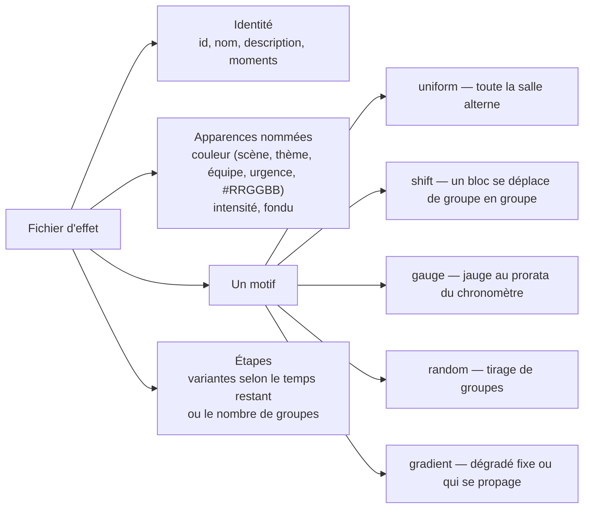

---
mockup:
  composant: ambiance_effects
  feature: declarative_sequencer
  version: 11.7.0
  type: architecture
  issue: "#223 #225 #299"
  validee_le: 2026-11-11
  complete: []
  remplace: []
---

# Effets lumière déclaratifs — architecture (v11.7.0)

Référence normative : `contracts/light-effects.md`.

## 1. Du fichier à l'ampoule

Un fichier utilisateur de même identifiant qu'un natif le remplace ; le supprimer restaure le natif. Un fichier invalide
est écarté et signalé, sans effet sur les autres ni sur le serveur.

## 2. Qui décide de ce que montre la zone générale

Les ampoules d'équipe ne passent jamais par ce schéma : elles gardent la couleur de leur équipe.

Le **groupe animateur** ne passe pas non plus par ce schéma : ni forçage manuel, ni essai, ni effet de salle. Le lecteur lui
calcule sa propre trame (réglage « effets du groupe animateur », même moment vivant) ; sans effet choisi, il reste en blanc fixe.

## 3. Ce qu'un fichier d'effet peut exprimer

Créer un effet = combiner un motif, des apparences et des étapes dans un fichier. Ajouter un **motif** nouveau demande une
évolution du serveur.
