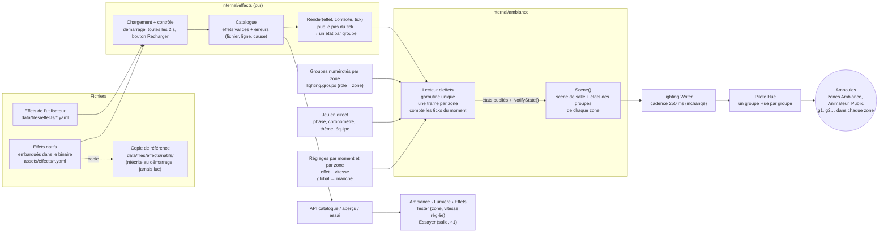
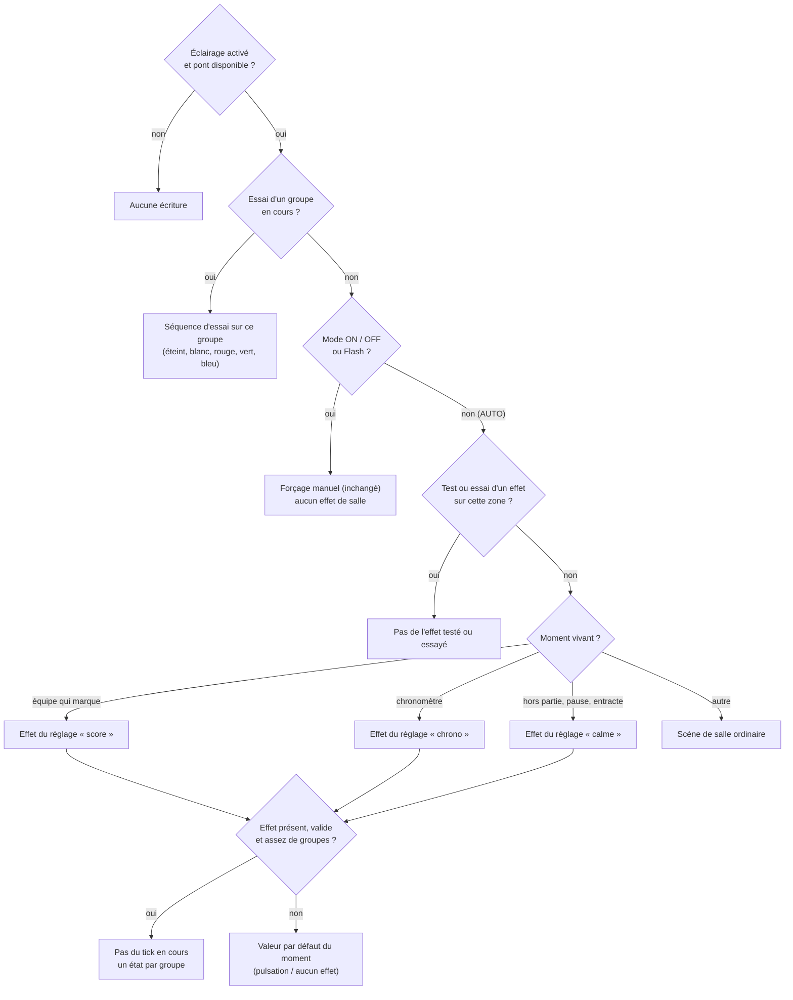
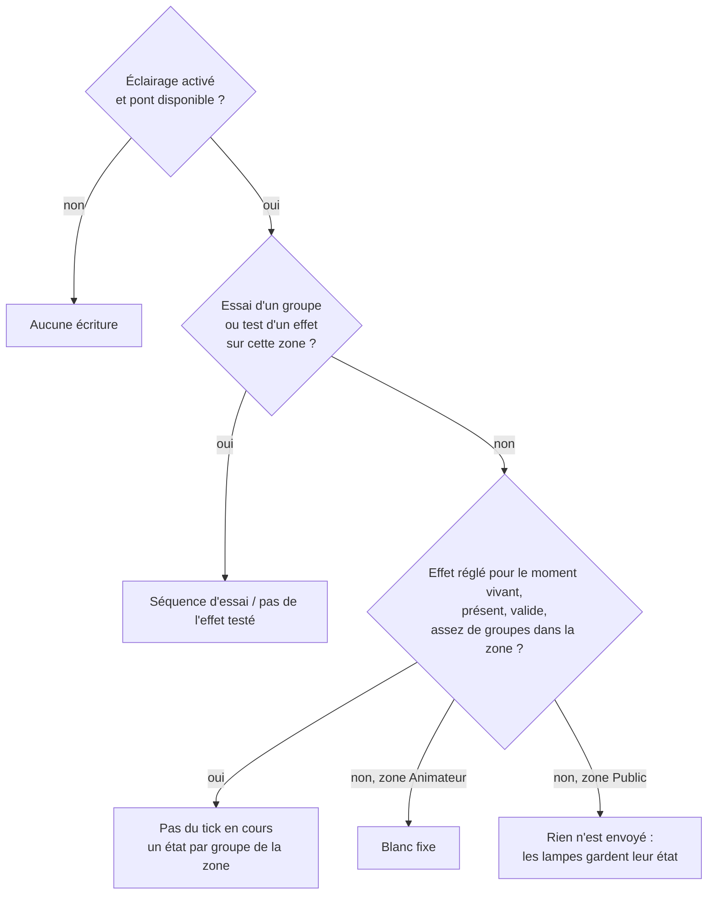
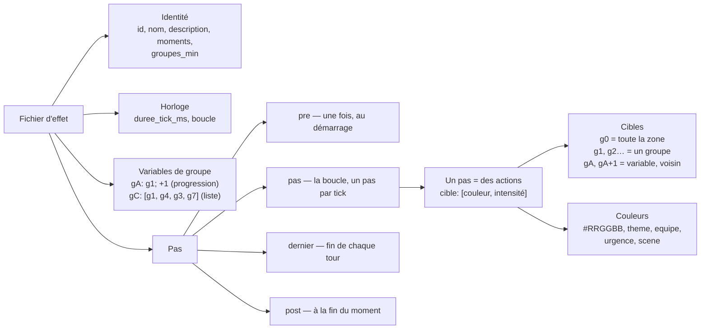
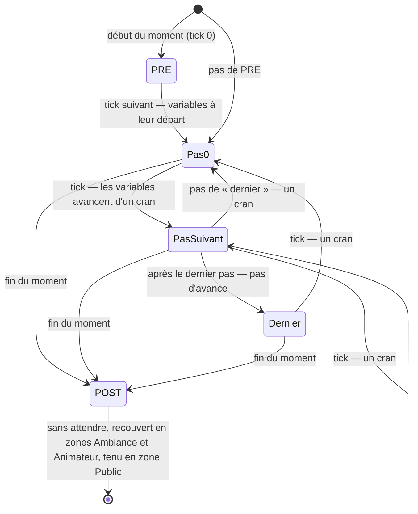

---
mockup:
  composant: ambiance_effects
  feature: step_sequencer
  version: 11.7.0
  type: architecture
  issue: "#223 #225 #299"
  validee_le: 2026-11-11
  complete: []
  remplace: [docs/mockup/v11.7.0/architecture/ambiance_effects__declarative_sequencer.md]
---

# Effets lumière pas à pas — architecture (v11.7.0, révision 4 : trois zones)

Référence normative : `contracts/light-effects.md`. Remplace `ambiance_effects__declarative_sequencer` : les schémas 1 et 2
sont repris et mis à jour (trois zones — ambiance, animateur, public —, groupes numérotés, vitesse, test), le schéma 3 est
réécrit pour le format pas à pas, le schéma 4 est nouveau.

## 1. Du fichier à l'ampoule

Un fichier utilisateur de même identifiant qu'un natif le remplace ; le supprimer restaure le natif. Un fichier invalide,
ou écrit dans l'ancien format, est écarté et signalé, sans effet sur les autres ni sur le serveur. La durée réelle d'un
tick est celle du fichier divisée par la vitesse réglée, sans descendre sous 250 ms.

## 2. Qui décide de ce que montre la zone Ambiance (la salle)

Les ampoules d'équipe ne passent jamais par ce schéma : elles gardent la couleur de leur équipe.

Les deux autres zones suivent un schéma plus court, sans forçage manuel ni scène de salle :

ON / OFF et le Flash n'agissent que sur la zone Ambiance. L'interrupteur général et l'arrêt du serveur éteignent les trois
zones. Autour d'un essai ou d'un test sur la zone Public, l'état des lampes est lu sur le pont puis rétabli.

## 3. Ce qu'écrit un fichier d'effet

## 4. Le déroulement d'un effet

Un même fichier se joue sur n'importe quelle zone : `g0` et `g1`…`gN` désignent toujours les groupes de la zone jouée. Un
groupe non cité par un pas garde son état. Un pas qui ne vise aucun groupe existant est sauté, sans tick et sans
avance. Les variables rebouclent sur le nombre réel de groupes : le fichier ne connaît pas la taille de la salle.
